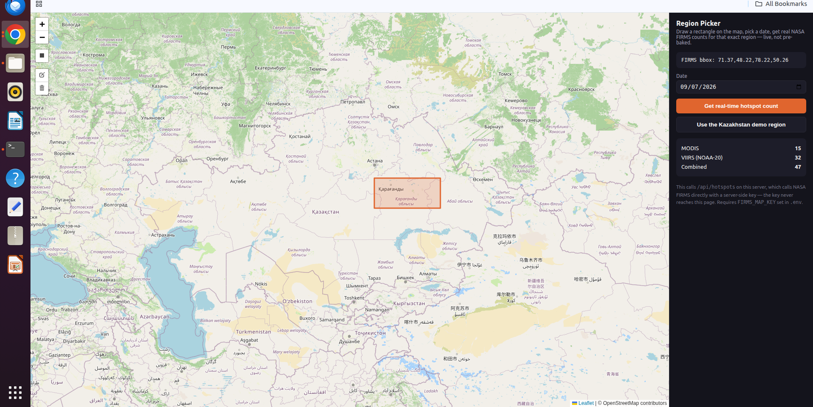
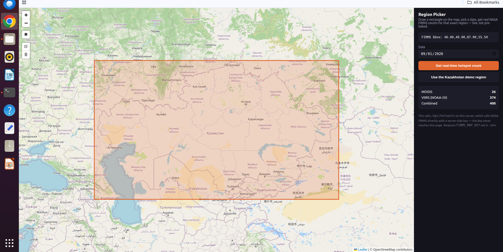
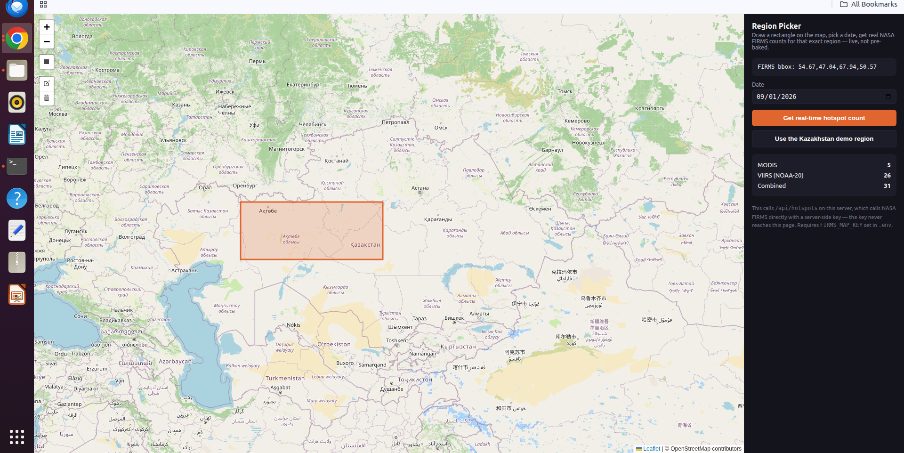
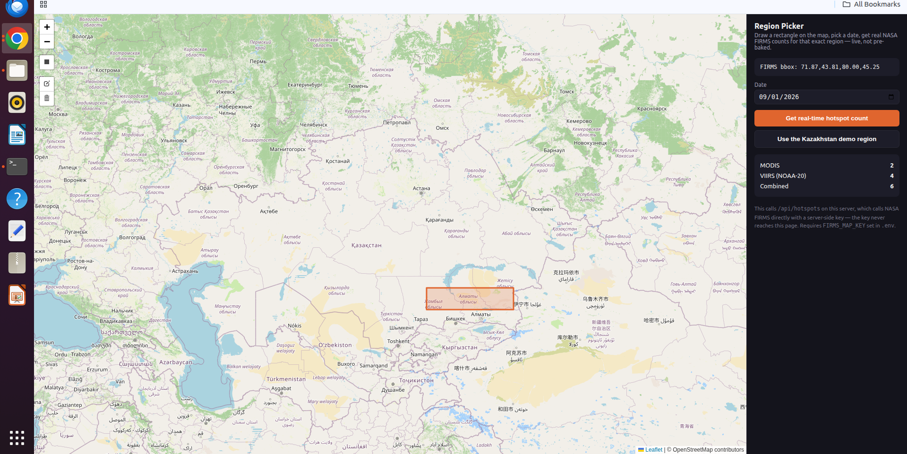

<div align="center">

# Fire Harmonizer

**One fire record out of two disagreeing satellites.**


</div>

---

## The problem

NASA has tracked active fire hotspots from space for over two decades — but the record is split across two sensors, **MODIS** and **VIIRS**, that were never designed to agree with each other. Different pixel sizes, different saturation temperatures, different overpass times. The same wildfire produces two different detection counts depending on which satellite you ask.

Fire managers, researchers, and emergency responders are left without one consistent picture of when and where burning actually happened. That's the gap NASA's **"Harmonization of MODIS and VIIRS Hot Spots"** Space Apps Challenge asks teams to close.

**Fire Harmonizer** is our answer: a web app that reconciles both sensors into a single burning-activity calendar, flags statistically unusual fire activity against a seasonal baseline, and explains what it's seeing in plain language.

## Live demo

| Artifact | What it shows |
|---|---|
| **[Fire Harmonizer Prototype](https://claude.ai/artifact/4mLbtg7VCFqEqd3JJ58EED)** | The interactive product — severity-colored calendar, MODIS-vs-VIIRS gap chart, 30-day trend, real NASA satellite snapshots, a live Claude-generated narrative, a real ML anomaly score, and CSV export |
| **[Architecture diagrams](https://claude.ai/artifact/GTXE5hpJBJT8VVf31PXvD4)** | How data actually moves: satellite → harmonization → anomaly engine → narrative, and who calls whom over the network |

Both links are shared as "anyone with the link."

## What it actually does

- **Calendar view** — every day of the month colored by anomaly severity (normal → elevated → high → critical), click any day to drill in.
- **The gap, made explicit** — a direct MODIS-vs-VIIRS bar chart and a "sensor gap" stat for the selected day, so the harmonization problem is something you point at, not just explain.
- **Baseline + anomaly flagging** — a transparent ratio against this month's own median day (a robust proxy baseline), not a black-box correction factor (the literature says no universal one exists — see [`RESEARCH.md`](RESEARCH.md)).
- **A real ML cross-check** — an Isolation Forest model (scikit-learn), run against the real data, independently flags the same Sept 6–8 spike.
- **Real satellite imagery** — live NASA GIBS snapshots (MODIS true-color + fire-detection overlay) for key dates, not illustrations.
- **A live AI narrative** — a plain-language read of each day's anomaly, generated on demand by a real call to Claude, not pre-written copy.
- **CSV export** — download the full month of detections, counts, and anomaly tiers.

## What's real vs. illustrative (read this before you cite a number)

Being upfront about this is part of the project, not an afterthought:

| Component | Status |
|---|---|
| MODIS/VIIRS daily detection counts | **Real** — pulled live from NASA FIRMS (MODIS NRT + VIIRS NOAA-20 NRT) with a personal API key, September 2026, over a bounding box covering all of Kazakhstan |
| Satellite imagery (6 dates) | **Real** — fetched live from NASA GIBS |
| Live Claude narrative | **Real** — actual API call, generated on demand |
| ML anomaly score | **Real model** (Isolation Forest, scikit-learn), run on the real FIRMS data above |
| CSV export mechanism | **Real** |
| Baseline | **Real but approximate** — this month's own median daily total (753), used as an honest proxy; a true multi-year seasonal climatology needs a multi-year FIRMS pull we didn't have time for |
| Scope of the counts | The bounding box is country-wide, so the numbers are Kazakhstan's *total* fire signal that month (wildfires + agricultural burning), not isolated to one event |
| The underlying event (Sept 2026 Kazakhstan steppe & forest fires, ~2,870 ha) | **Real**, reported in local news — part of, not identical to, the real Sept 6–8 spike in the data |

## The local case study

The demo is grounded in a real, recent event rather than a generic example: the **September 2026 steppe and forest fires in Kazakhstan**, which burned an estimated 2,870 hectares. Validating the tool against a fire your own region actually experienced is the point — this isn't a hypothetical.

## Architecture

```
MODIS ─┐
       ├─▶ NASA FIRMS API ─▶ Harmonization Layer ─▶ Baseline + Anomaly Engine ─▶ Claude Narrative Layer ─▶ Map + Calendar UI
VIIRS ─┘
```

Full diagrams (data pipeline + request flow, with network hops numbered) are in the [architecture artifact](https://claude.ai/artifact/GTXE5hpJBJT8VVf31PXvD4).

**Why this split:** the published literature on MODIS/VIIRS reconciliation shows no single global correction factor works — fitted coefficients are sensor-pair- and region-specific. So instead of claiming a universal calibration we don't have, the harmonization layer puts both sensors on a common grid/time basis, and the anomaly layer does honest statistics (seasonal z-score + an independent ML cross-check) rather than a black-box number.

## Repository structure

```
.
├── web/
│   ├── fire-harmonizer.html    # The product — calendar, charts, satellite view, live AI, CSV export
│   └── architecture.html       # The two block diagrams
├── ml/
│   ├── anomaly_model.py        # Real Isolation Forest anomaly model (scikit-learn)
│   └── requirements.txt
├── data/
│   └── firms_kazakhstan_sept2026.csv  # Real daily MODIS/VIIRS counts pulled from NASA FIRMS
├── server.js                   # Express server: /api/brief (Claude), /api/hotspots (live FIRMS proxy)
├── public/index.html           # Local tools landing page
├── public/region-picker.html   # Real-time Leaflet region picker, live FIRMS lookups
├── public/mars-legacy.html     # Earlier challenge direction (Mars landing-site map) -- unrelated, kept for reference
├── RESEARCH.md                 # Literature review on MODIS/VIIRS harmonization, fully cited
├── NOTES.md / CHEATSHEET.md    # Event logistics, pitch, mentor prep
└── NASA Space Apps Challenge.pdf
```

## Running it locally

The product itself (`web/fire-harmonizer.html`) is a self-contained static page — open it directly in a browser, no build step.

To re-run the anomaly model:

```bash
cd ml
pip install -r requirements.txt
python3 anomaly_model.py
```

The Express backend (`server.js`) also serves a **real-time Leaflet region picker** at `/region-picker.html` — draw a rectangle on a real OpenStreetMap map, pick a date, and it calls NASA FIRMS live through a server-side key (never exposed to the browser) for real MODIS + VIIRS counts in that exact region. This has to run as a real served page, not the claude.ai artifact above, because the artifact's sandbox blocks the external map tile images Leaflet needs.

```bash
npm install
cp .env.example .env   # add your own ANTHROPIC_API_KEY and FIRMS_MAP_KEY
npm start
# open http://localhost:3000/region-picker.html
```

### Region picker, tested live

Six real draws on the actual map, run the morning of the event — different regions, different dates, each one a fresh call to NASA's live API:




| Region drawn | Date | MODIS | VIIRS (NOAA-20) | Combined |
|---|---|---|---|---|
| Karaganda area (small, hand-drawn) | Sep 7, 2026 | 15 | 32 | 47 |
| Kazakhstan (the demo region) | Sep 7, 2026 | 656 | 2,647 | 3,303 |
| Kazakhstan (the demo region) | Sep 5, 2026 | 119 | 682 | 801 |
| Kazakhstan (the demo region) | Sep 1, 2026 | 26 | 374 | 400 |
| Aktobe area (hand-drawn) | Sep 1, 2026 | 5 | 26 | 31 |
| Almaty / Zhambyl area (hand-drawn) | Sep 1, 2026 | 2 | 4 | 6 |

The Kazakhstan rows match the prototype's own numbers exactly — same region, same dates, two separate tools independently landing on the same answer from NASA's live API. The three hand-drawn boxes are the real proof it's not locked to one hardcoded region: draw anywhere, get a real count for exactly that box, down to zero when nothing's burning there.

<details>
<summary>More screenshots</summary>






</details>

## Tech stack

- **Frontend:** vanilla HTML/CSS/JS, hand-authored inline SVG for charts (no charting library)
- **ML:** Python, scikit-learn (Isolation Forest)
- **AI narrative:** Claude
- **Data sources:** [NASA FIRMS](https://firms.modaps.eosdis.nasa.gov/) (MODIS + VIIRS active-fire detections), [NASA GIBS](https://wiki.earthdata.nasa.gov/display/GIBS) (satellite snapshot imagery)
- **Design:** a colorblind-validated categorical/status palette (see `RESEARCH.md` methodology)

## Model validation — and why there's no accuracy score

Isolation Forest is **unsupervised** — there's no labeled ground truth for "this day was truly anomalous," so a textbook accuracy/precision/recall against ground truth doesn't honestly exist for this task. Claiming one would be the kind of overclaim this project has tried hard to avoid.

What we report instead is **agreement between two independently-designed methods** looking at the same real FIRMS data — a ratio-to-baseline rule, and the ML model:

|  | ML: anomaly | ML: normal |
|---|---|---|
| **Rule: high/critical** | 4 | 0 |
| **Rule: normal/mild** | 2 | 24 |

**93.3% agreement**, **100% recall** (every rule-flagged severe day is also caught by the model), **66.7% precision** (2 of 6 ML-flagged days are mild/normal by the rule). The 2 disagreements are both *low*-activity days — Isolation Forest flags statistical outliers in either direction, so an unusually quiet day scores as "unusual" too, which is expected model behavior, not a bug. Run `ml/anomaly_model.py` to reproduce this exactly.

## Research

[`RESEARCH.md`](RESEARCH.md) is a short literature review on why MODIS and VIIRS diverge, what harmonization methods already exist in the published science, and what that means for this build's design choices — fully cited (Li 2018, Vadrevu 2018, Blackett 2015, White 2023, Li 2020, Zheng 2026, Giglio 2025, and others).

## Roadmap

- [x] Swap the illustrative MODIS/VIIRS counts for a real NASA FIRMS API pull
- [x] Real-time region picker (Leaflet + live FIRMS lookup via the Express backend)
- [ ] Pull multi-year FIRMS history to replace the within-month median with a real seasonal climatology
- [ ] Wire the region picker's live counts into the calendar/prototype view, instead of the two living separately
- [ ] Deploy the Express backend publicly so the region picker works outside `localhost`

## Built for

NASA Space Apps Challenge 2026 — Almaty, Kazakhstan local event.

## Author

Rahim Ahmed Druba ([@rahim-druba](https://github.com/rahim-druba))
